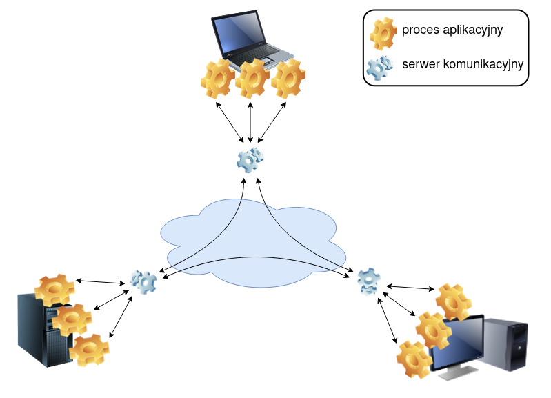

# Rozproszony Monitor

## Użyte narzędzia

1. Java RMI
2. Serializacja danych z użyciem JavaVM

## Architektura



1. Serwery (```Distributed Server```) tworzą sieć połączoną każdy z każdym, połączone za pomocą interfejsu RMI -
   ```CommunicationInterface```
2. Adapter API Klienta (```DistributedMonitorImpl```) oraz jego interfejs ```DistributedMonitor```: Warstwa uruchamiana
   po stronie aplikacji klienckiej, udostępniająca standardowe, bezparametrowe prymitywy współbieżności znane z Javy (
   lock(), unlock(), await(), signal(), signalAll()).

## Działanie algorytmów

### ```monitor.lock()```

**Żądanie**: Klient wywołuje lock(). Serwer, którego używa zwiększa swój zegar logiczny Lamporta, zmienia
stan na **WANTED** i rozsyła komunikat ```receiveLockRequest(nodeId, timestamp)``` do wszystkich połączonych węzłów.

**Głosowanie**: Węzły, które nie potrzebują obecnie blokady, odpowiadają natychmiast (
```void receiveLockReply(long timestamp)```). Węzły trzymające blokadę lub konkurujące o nią z niższym znacznikiem czasu
odkładają swój głos na później (defer).

**Pozyskanie blokady**: Klient żądający blokady jest lokalnie zawieszany na swoim węźle macierzystym, dopóki licznik
zgód nie
osiągnie wartości approvals == peers.size(). Gdy wszystkie odpowiedzi spłyną, stan węzła zmienia się na
**HELD**, a klient wchodzi do sekcji krytycznej.

### ```condition.await()```

Nową zmienną warunkową można zarejestrować poprzez ```monitor.newCondition(condition_name)```

**Rejestracja**: Klient wywołuje await(). Węzeł macierzysty tworzy obiekt Waiter zawierający unikalny
identyfikator klienta oraz znacznik czasu Lamporta, dodaje go do swojej lokalnej kolejki priorytetowej (PriorityQueue) i
rozsyła komunikat ```receiveWait(...)``` w celu zsynchronizowania kolejek na wszystkich węzłach rówieśniczych.

**Zwolnienie Blokady**: Węzeł macierzysty atomowo zrzeka się blokady, natychmiast rozsyłając wszelkie odłożone wcześniej
odpowiedzi do czekających rówieśników.

**Zawieszenie**: Węzeł macierzysty mapuje unikalny identyfikator wątku klienta na lokalny obiekt Condition w
Javie i usypia ten wątek lokalnie.

### ```condition.signal()```

**Wybór**: Wątek na dowolnym węźle wywołuje ```signal()```. Sprawdza szczyt swojej zsynchronizowanej kolejki
priorytetowej (PriorityQueue), aby odnaleźć najstarszego oczekującego klienta w całym klastrze (najniższy znacznik czasu
logicznego).

**Rozgłoszenie**: Pobiera tego klienta z kolejki i rozsyła komunikat ```receiveSignal(...)``` zawierający
jego tożsamość do wszystkich rówieśników.

**Wybudzenie**: Wszystkie węzły rówieśnicze usuwają wybranego klienta ze swoich kolejek. Konkretny rówieśnik
posiadający docelowy wątek pobiera odpowiadający mu lokalny obiekt Condition i wywołuje na nim metodę .signal(),
wybudzając uśpiony wątek klienta.

**Ponowne pozyskanie**: Nowo wybudzony wątek nie wznawia działania natychmiast. Od razu próbuje wykonać (
```acquireLock()```), aby ponownie stanąć do walki o blokadę Ricarta-Agrawali.

### ```monitor.unlock()```

**Zwolnienie blokady**: Węzeł zmienia stan z HELD na RELEASED, dzięki czemu natychmiast zgadza się na prośby innych
węzłów.

## Uruchomienie programu

Może być potrzebna wersja javy 26 (ale być może wystarczy zmienić w ```pom.xml``` wersję na obowiązującą w systemie)

compile:

```bash
mvn clean compile

# lub:
/mvnw compile
```

run servers, set different ports:

```bash
mvn exec:java -Pserver
mvn exec:java -Pserver -Dexec.args="1100"
```

run clients, set server ports:

```bash
mvn exec:java -Pcons -Dexec.args="1100"
mvn exec:java -Pprod -Dexec.args="1100"
```
